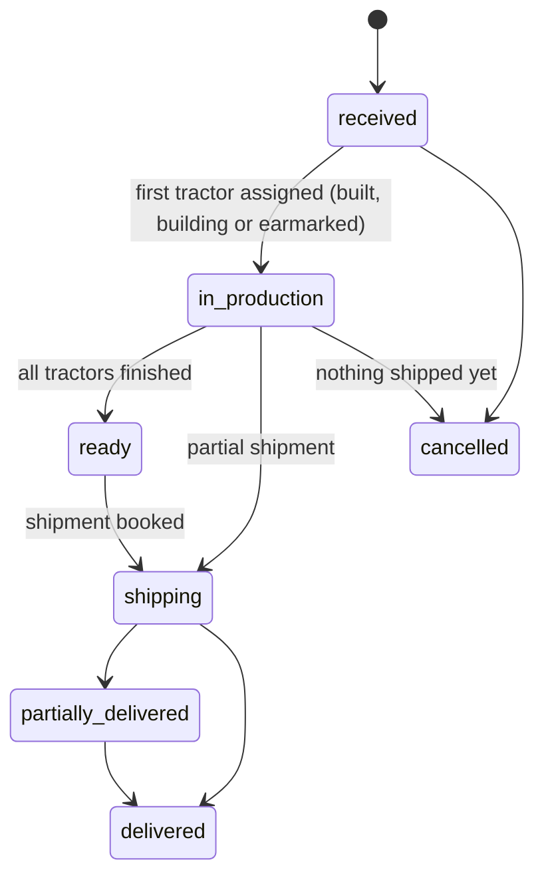
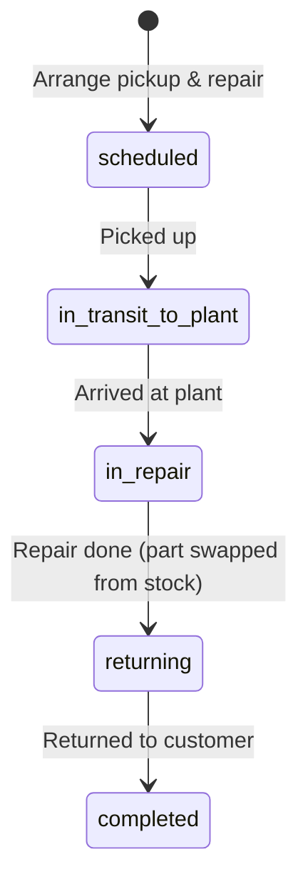
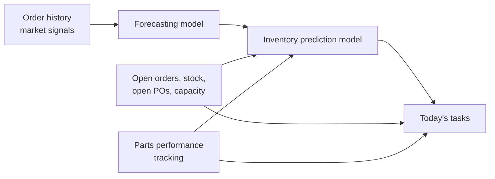

# RKB Obsidian Internal Portal — Flows & User Journeys

What the prototype portal lets an internal user do today, step by step, and the rules
behind each screen. It complements the [solutions doc](../solutions/prototype.solution.md)
(what was asked for) and the [project README](../../README.md) (how to run it).

Everything here describes the **current prototype**: the AI/ML models are mocked with
transparent formulas, notifications are logged rather than delivered, and there are no
user accounts.

## Contents

1. [Who uses it and how it is organised](#1-who-uses-it-and-how-it-is-organised)
2. [Records and their lifecycles](#2-records-and-their-lifecycles)
3. [The daily task list](#3-the-daily-task-list)
4. [User journeys](#4-user-journeys)
5. [Page reference](#5-page-reference)
6. [How the numbers are produced](#6-how-the-numbers-are-produced)
7. [Prototype data and limits](#7-prototype-data-and-limits)
8. [Journey ↔ test coverage](#8-journey--test-coverage)

---

## 1. Who uses it and how it is organised

**Users:** RKB Obsidian's internal operations staff — planners, buyers, plant and
fulfilment coordinators, quality and service staff. The portal is one shared view; any
user can take any action.

**Navigation** (left sidebar):

| Group | Page | Answers |
|---|---|---|
| — | **Dashboard** | What needs doing today, what it blocks, who is affected |
| — | **Supply & demand plan** | What demand is coming, what to build and when, what parts to buy |
| — | **Cost & efficiency** | Are we over- or under-spending against actual demand, for any period |
| Fulfilment | **Customer orders** | Every order, its progress and risk |
| Fulfilment | **Tractors** | Every tractor built, its status, and every part in it |
| Fulfilment | **Shipping** | Parts on their way in, tractors on their way out, service hauls |
| Fulfilment | **Service & repairs** | Tractors collected from customers for repair |
| Fulfilment | **Notifications** | Messages sent to the plant, yards, suppliers and customers |
| Supply | **Parts inventory** | Balances, pending orders and requirements per part |
| Supply | **Parts orders** | Purchase orders placed with suppliers |
| Supply | **Suppliers** | Reliability scores, delivery and quality history |
| Quality & accounts | **Failures & issues** | Failures, supplier trends, recurring problems |
| Quality & accounts | **Customers** | Orders, fleet in the field, open issues |
| Quality & accounts | **How it works** | The mocked models and the data |

**Global search** (top bar) jumps straight to a record from its identifier: `SO-…`
(customer order), `PO-…` (parts order), `FR-…` (failure report), `SUP-…`, `CUS-…`,
`T-…` or a `RKB-…` tractor serial, `IP-…` or a part serial number, a part number such as
`ENG-75`. Anything else searches tractors.

**Part previews.** Hovering any link to a part (tables, task chips, the dashboard's
parts list, recommendations, failures) shows a preview: a small tractor drawing with
that part highlighted, its name, what it does in the tractor, and the models that use it.

**Conventions used on every page**

- Buttons act immediately and confirm with a toast. Cancelling an order, and rushing or
  expediting from an order or PO page, ask first; task buttons act straight away (the
  task already states the cost). The page re-renders and the models re-run after every action.
- Filters, tabs and date ranges live in the URL, so any view can be bookmarked or shared.
- Every identifier is a link to its record; tables sort by clicking a column header.
- Dates shown are relative to the portal's "today" (the server's date, or `RKB_TODAY`).

---

## 2. Records and their lifecycles

### Customer order (`SO-YYYY-NNNN`)

Fields from the diagram: status, quantity, submission date, expected delivery date,
actual delivery date, customer, delivery address. The prototype adds model, region,
unit price and **priority** (`normal` or `rush`).

### Tractor (`T-NNNNN`, serial `RKB-TX300-YYWW-NNNNN`)

`in_production` (1 working day per tractor per build bay) → `qc_hold` (failed end-of-line
test, waiting for a replacement part) → `inventoried` (finished, unassigned stock) or
`earmarked` (finished, reserved for an order) → `shipping` → `delivered` → `in_repair`
(collected for repair) → `delivered`.

Each tractor records its model, build lot, order, and every part installed — serial
number for serialized parts (engines, transmissions, axles, pumps, lifts, cabs, frames,
control units), lot number for lot-tracked parts (doors, handles, harnesses, batteries,
lights, tyres, seats, filters, fasteners). Parts replaced in a repair stay on the
record, marked with the date they were removed.

### Parts order / inventory order (`PO-YYYY-NNNNN`)

`submitted` → `confirmed` → `in_transit` (supplier shipped; carrier ETA known) →
`received` (accepted units go into stock; rejected units are logged as a receiving
failure). A PO can be a **rush** order, with the premium recorded.

### Inventory part (`IP-NNNNNN`)

`in_stock` → `installed` (serialized, in a tractor) or `consumed` (lot used up);
`rejected` at receiving; `scrapped` when it fails in build/QC or is replaced in a repair.

### Failure report (`FR-NNNNN`)

Stage `receiving`, `manufacturing` or `field`; severity `low` → `critical`;
status `open` → `investigating` → `resolved`. Linked to the part number, supplier, the
exact unit or lot, the parts order it came on, the tractor and the customer.

### Service job (`SJ-NNNNN`)

Completing a job resolves the linked failure. Hauling, labour and parts costs are
recorded on the job.

### Notification (`NT-NNNNN`)

Sent to a **site** (plant or distribution yard), a **supplier** or a **customer**, with
an urgency, about a record (order, PO, failure, tractor or part). `sent` →
`acknowledged`. The prototype logs notifications; it does not email them.

### Shipment (`SH-NNNNN`)

Direction `inbound` (parts from a supplier), `outbound` (tractors to a customer),
`service_pickup` / `service_return` (repair hauls). `in_transit` → `delivered`. Outbound
and service shipments carry their freight cost; rush shipments are flagged.

---

## 3. The daily task list

The dashboard's **What do you need to do today** is generated from the plan and the live
records every time the page loads. Each task has a severity, a due date, what it is
blocking, the customers affected, links, a primary action and secondary actions.

**Filters:** *Due now* (due today, overdue, or critical), *This week*, *All*; then by
category. **Snooze** hides a task until tomorrow; **✓** marks it done.

| Task | Category | Appears when | Severity | Primary action | Other actions |
|---|---|---|---|---|---|
| Order parts | Purchasing | A purchase recommendation's order-by date is past or within 7 days | Critical if overdue and blocking a customer order; high/medium otherwise | **Rush PO** when a normal order would land late; otherwise **Place PO** | Place PO (normal), Notify plant |
| Chase a late PO | Purchasing | Quoted delivery date has passed and the supplier hasn't shipped | High if blocking builds, else medium | **Expedite (+15%)** | Notify supplier, Mark shipped |
| Receive & inspect | Receiving | A shipment's carrier ETA is today or past | High if builds are waiting on the part | **Mark received** | — |
| Clear QC hold | Production | A tractor failed end-of-line test | High | **Install replacement & release** (if the part is in stock) | Notify plant |
| Finish build & QC | Production | A build started before today is still in production | Medium | **Pass QC** | — |
| Start build | Production | The plan schedules a build today/next working day and a full parts kit is on hand | Medium (high if late); low for forecast builds | **Start N builds** | — |
| Earmark stock | Fulfilment | An unassigned tractor (finished or still on the line) can cover an open order | Medium | **Earmark** | — |
| Ship order | Fulfilment | Order ready and ship-by date within 7 days (partial: ship-by date passed) | High if ship-by passed | **Book shipment** | — |
| Confirm delivery | Fulfilment | An outbound shipment's ETA has passed | Low | **Mark delivered** | — |
| Order at risk | Customer | The plan projects an order late, or some of its builds short of parts | High if late, medium if at risk | **Rush this order** | Notify plant, Update customer |
| Tractor down | Service | Critical/high field failure on a tractor at a customer site with no repair under way | The failure's severity | **Arrange pickup & repair…** | Start investigation, Notify customer |
| Service step | Service | A repair job's next step is due (pickup date, plant arrival, repair, return) | High for rush jobs | **Picked up / Arrived at plant / Repair done / Returned** | Rush the replacement part if none in stock |
| Triage failure | Quality | Any other open failure report | The failure's severity (receiving: low) | **Start investigation** (receiving: **Mark returned**) | — |
| Supplier quality review | Quality | Parts performance flags a part failing at 2× its category rate | Low | **Raise with supplier…** | — |

Tasks are sorted by severity, then due date. "Overdue Nd" means the due date passed N
days ago.

---

## 4. User journeys

Each journey lists where to start, what to click, and what changes. Names in **bold**
are buttons or links in the portal.

### J1 · Start the day

1. Open **Dashboard**. The layout follows the sketch: inventory of parts down the left,
   *What do you need to do today* in the centre with *Demand for the next 90 days*
   below, *Current inventory of tractors* and *Current orders* on the right.
2. Read the KPI strip: tasks due now (critical count), parts POs to place this week,
   tractors to build, orders at risk, recommended parts spend and build capacity used
   for the planning horizon.
3. Work the task list top-down (*Due now*). Use the category chips to split work
   between buyers, plant, fulfilment, service and quality.
4. Scan the parts column: parts marked **Critical** cannot be fixed in time by a normal
   order; **Order now** needs a PO this week. The bar shows on hand (solid) and on
   order (faded) against the 90-day requirement.
5. Scan *Current orders* for **At risk** / **Late** badges; open any order for detail.

### J2 · Resolve a critical parts shortage

*Start:* a critical **Order … (part)** task, e.g. the dealer fleet order of six TX-500s
outrunning 180 hp engine supply.

1. Read the task: needed-by date, order-by date, effective lead time, how many builds
   and which customer orders it blocks, and whether even an order placed today lands late.
2. If a normal order would land late, the primary button is **Rush PO · +$premium, in
   stock MM-DD**: half the quoted lead time from the fastest supplier, at a 15%
   premium. Otherwise click **Place PO**.
3. Optionally **Notify plant** — a prefilled, urgent message about the shortage and
   when parts land so the build sequence can change.
4. *Result:* the PO is created (marked rush with its premium), the plan counts it as
   incoming supply at its predicted arrival, the recommendation and task disappear, and
   the order's risk updates. The notification is logged on the part and on
   **Notifications**.

Also reachable from **Supply & demand plan → Parts to purchase** (Place PO / Rush) and
from a part's page (**Recommended orders**, **+ Order this part**).

### J3 · Chase, expedite and receive supplier deliveries

1. A **Chase {supplier} on PO-…** task appears once the quoted date passes without a
   ship notice. It shows how late it is and which builds/customers it blocks.
2. **Expedite (+15%)** converts it to a rush order: a new, earlier due date and a 15%
   premium on the outstanding quantity. **Notify supplier** sends a prefilled message
   asking for a ship date. **Mark shipped** records the supplier's ship notice (creates
   the inbound shipment with a carrier ETA).
3. When the truck is due, a **Receive & inspect** task appears (also on **Shipping** and
   **Parts orders**). **Receive…** asks how many units failed inspection: accepted units
   go into stock with serial/lot numbers; rejected units create a receiving failure,
   which later shows as **Return N rejected … to supplier**.
4. *Result:* stock and plan update immediately; supplier on-time and reject history feed
   the supplier's reliability score.

### J4 · Protect a customer order at risk

1. An **SO-… at risk** or **projected N days late** task explains why: parts short
   (which ones) and/or build capacity.
2. **Rush this order** marks it rush: its remaining builds move to the front of the
   build queue from today, and it ships with expedited freight (one day faster, +15%).
3. **Notify plant** asks the plant to prioritise its builds; **Update customer** sends a
   prefilled delivery update.
4. If the cause is parts, resolve them with J2/J3. Check the order page: **Plan for
   remaining tractors** shows each build's date, parts-ready date and status.
5. Unassigned stock that can cover the order shows on the order page (**Earmark**).

### J5 · A tractor is down at a customer site: pickup, repair, return

*Start:* a **{customer}'s {serial} is down: {part}** task (critical or high field
failure), the failure's page, or the tractor's page.

1. **Arrange pickup & repair…** opens a dialog: pickup date (today for critical
   failures), priority (rush = +15% haulage, one day faster each way), notes, and
   *Tell the customer the pickup date* (sends them a notification with the pickup and
   expected return dates).
2. **Book pickup** creates the service job and opens it. The failure moves to
   *investigating*. The job shows a timeline, cost so far and its hauls.
3. Work the job's steps from the job page or the task list:
   **Picked up** (tractor status → in repair; pickup haul created) →
   **Arrived at plant** → **Repair done — ship back** (the failed unit is marked
   replaced and scrapped, a replacement is installed from stock, labour and parts costs
   are recorded, the return haul is created) → **Returned to customer**.
4. *If the replacement part isn't in stock,* the repair step is blocked with a clear
   message and the task offers **Rush {part} (+15%)**; receive it (J3), then repair.
5. *Result:* job completed, tractor back to *delivered*, failure resolved with a link to
   the job, full cost (haul + labour + parts) visible on the job and in **Cost &
   efficiency**. The tractor's page lists its **Service history**.

### J6 · Review the predictions and order parts when needed

1. Open **Supply & demand plan**. The KPIs summarise tractor demand (firm + forecast),
   demand covered by existing stock, builds planned, builds at risk, and recommended POs
   and spend.
2. **Planning assumptions** — change the forecast level (P50 expected, P75 cautious,
   P90 conservative), safety stock days, build bays, horizon and receiving time, then
   **Re-run plan**.
3. **Demand forecast** — monthly history and forecast, the next 90 days by week with a
   P10–P90 range, the economic factor (market trend, inflation), seasonality, backtest
   accuracy, and a per-model table. Switch models with the tabs.
4. **Tractors to build, by week** against build capacity, and **Tractor demand by
   delivery week** (firm built, firm to build, forecast).
5. **Parts to purchase** — *Act now* or *All* recommendations: urgency, quantity,
   supplier (score and lead time), order-by and need dates, cost, what it blocks.
   **Place PO**, or **Rush** where a normal order would land late.
6. **Build plan** — every planned build with build date, latest start, ship-by, parts
   ready date and status. **Start now** appears only when a full parts kit is on hand.
7. **Parts requirements** — per part: on hand, on order, firm and forecast need, loss
   rate, safety stock, lowest projected stock with existing supply, first shortfall, and
   quantity to buy. A part's page charts projected stock with and without the
   recommended orders against safety stock.

### J7 · Use stock before building more

1. **Use existing stock first** on the plan, **Earmark** tasks on the dashboard, and
   suggestions on order pages list unassigned tractors that can cover demand.
2. **Earmark** (or **Earmark to order…** on a tractor's page, which lists open orders
   for that model) reserves it. The plan stops scheduling a new build for that unit.

### J8 · Build, QC, ship and deliver

1. **Start build** tasks, **Start now** on the plan, or **Start N builds** on an order
   page start builds: parts are drawn first-in-first-out from stock and recorded on the
   tractor. Builds are refused, with the missing parts listed, if a kit isn't on hand or
   the day's build bays are full.
2. Next working day: **Pass QC** (task or tractor page) → *earmarked* (for an order) or
   *inventoried* (stock).
3. A tractor that failed QC sits on **QC hold**; **Install replacement & release** fits a
   new unit from stock and resolves the manufacturing failure.
4. **Book shipment** (task or **Ship N ready tractors** on the order) creates the
   outbound shipment with ETA and freight cost; **Mark delivered** (task, order or
   **Shipping**) completes delivery and the order's actual delivery date.

### J9 · Take a new customer order, or cancel one

1. **+ New order** (Customer orders or Customers): customer, model, quantity, expected
   delivery date, optional delivery address and notes.
2. *Result:* the order is *received*; the plan immediately includes it (firm demand,
   builds, parts), and stock that can cover it is suggested.
3. **Cancel order** (only before anything ships) returns its tractors to stock.

### J10 · Review supply-chain cost efficiency for any time frame

1. Open **Cost & efficiency**. Pick a preset (last 30 days, 90 days, year to date,
   12 months, 3 years) or a custom from/to and **Apply**.
2. KPIs: parts purchased; parts needed by actual demand; **over-/under-bought vs.
   demand** ($ and %); rush premiums; inventory carrying cost and turns; late deliveries.
3. **What the numbers say** — plain-language findings for the period (over/under
   buying, rush spend and where it went, carrying cost and days of supply, excess
   stock, late deliveries, quality losses, repair costs).
4. Charts: purchased vs. consumed vs. needed by actual demand per month; parts
   inventory value over the period; one-month-ahead forecast vs. actual tractors ordered.
5. **Where the money went** — parts, rush premiums, outbound freight (incl. rush
   freight), carrying cost, service hauling, repair labour and parts, line scrap,
   receiving rejects; parts cost per tractor built.
6. **By part** (bought vs. used, bought ÷ used, spend, rush premium, excess stock today)
   and **By supplier** (spend, share, rush orders and premium).

### J11 · Review supplier and parts quality; act on recurring problems

1. Open **Failures & issues**. Set the date range (same presets as J10).
2. KPIs: unresolved issues, field, manufacturing and receiving counts, recurring
   patterns (how many rising), suppliers getting worse.
3. **Supplier trends** — one line per supplier (3-month rolling average) for
   *failures per 1,000 units*, *on-time delivery* or *avg days late*. Suppliers getting
   worse are marked ▲ in the legend.
4. Tabs:
   - **Recurring failures** — the same part, supplier and symptom 3+ times: units,
     first/last seen, trend (rising/steady/falling), spread across customers and lots,
     open count. **Raise with supplier…** sends a prefilled request for root cause and
     corrective action.
   - **Lot clusters** — lots with more than one failure.
   - **Repeat late deliveries** — supplier/part pairs late 3+ times, late rate, average
     and worst days late; **Raise with supplier…**.
   - **Parts performance** — score per part × supplier, failures by stage, failure rate
     vs. category, on-time, days late; plus tracker flags (quality reviews, sourcing
     shifts).
   - **Supplier reliability** — reliability scores side by side.
5. Drill into a supplier (**Suppliers → name**): reliability score, on-time, days late,
   failures per 100 units, a *Getting worse* callout when applicable, trend charts,
   recurring issues for that supplier, per-part performance, open and recent orders,
   recent failures, and **Notify supplier…**.

### J12 · Log and work a failure

1. **+ Log failure** (Failures & issues), **Log failure…** on a tractor, or **Log issue…**
   on an inventory part. Choose stage, severity, class and description; for a tractor,
   pick the part — the portal links the exact installed unit, its supplier and PO, and
   the customer.
2. The failure appears in the task list (triage or *tractor down*). On its page:
   **Start investigation**, **Arrange pickup & repair…** (field failures), **Notify
   customer…/supplier…**, **Resolve…** (with resolution text), **Reopen**.
3. The failure page shows other failures from the same lot, linked service jobs and
   notifications.

### J13 · Trace a part or tractor

- Tractor → **Tractor at a glance**: a drawing of that tractor (cab or open station,
  dual rear tyres on the TX-500) with every part in its bill of materials as its own
  region. Colour it by **This tractor's health** (no issues / failed before or replaced /
  open failure), **Supplier** of the installed unit, or plain **Parts**. Hover a part
  to see it; click it (or its chip below the drawing) to keep it selected. The panel
  shows what the part does, the exact unit or lot installed with supplier, PO and
  install date (and anything replaced in a repair), and failures on this tractor. The
  page opens with the part that has an open failure already selected.
- Part → **Where it goes**: the part highlighted on each model that uses it (switch
  models with the tabs), with its description and quantity per tractor.
- Tractor → **Parts installed (traceability)**: every part with serial or lot,
  supplier, parts order, received and installed dates (and replaced date).
- Unit or lot (`IP-…` or serial) → the tractors it went into, its PO and supplier, its
  failures.
- PO → the units/lots received on it, receiving issues, shipments, notifications.
- Use global search with any identifier to jump directly.

### J14 · Watch shipping

**Shipping** (in transit / recently delivered): inbound parts with carrier ETA vs.
supplier quote (late flags, **Receive**), outbound tractors with ETA vs. customer
expectation and freight cost (**Mark delivered**), and service hauls to and from repair
(**Arrived at plant** / **Returned**). Progress bars show days elapsed in transit.

### J15 · Housekeeping

- **Snooze** / **✓** on tasks.
- **Notifications → Mark acknowledged** when a recipient confirms.
- **Reset demo data** (sidebar) rebuilds all prototype data from the source dataset.
- Theme toggle (top right) switches light/dark.

---

## 5. Page reference

| Page | Shows | Actions |
|---|---|---|
| Dashboard | KPIs, task list, parts inventory, tractor inventory by model × status, current orders with progress and risk, 90-day demand by delivery week | All task actions, snooze, done |
| Supply & demand plan | Assumptions, forecast, build plan, demand, purchase recommendations, orders at risk, stock netting, parts requirements | Re-run plan, Place PO, Rush, Start now, Earmark |
| Cost & efficiency | Date-ranged spend, demand need, inventory, carrying cost, rush, freight, repairs, late deliveries, forecast vs. actual, by part, by supplier | Date range |
| Customer orders / order | Filterable list; order timeline, risk, plan for remaining tractors, tractors, shipments, issues, notifications | New order, Start builds, Ship, Rush, Notify plant, Update customer, Cancel, Earmark |
| Tractors / tractor | Filterable list; tractor details, failures, shipping, interactive parts diagram coloured by health or supplier, parts traceability, service history | Pass QC, Install replacement & release, Earmark to order, Arrange pickup & repair, Log failure |
| Shipping | Inbound, outbound and service shipments | Receive, Mark delivered, Arrived at plant, Returned |
| Service & repairs / job | Active and completed jobs with cost; job timeline, cost breakdown, hauls | Picked up, Arrived at plant, Repair done, Returned, Update customer |
| Notifications | Every message with recipient, urgency, subject and related record | New notification, Mark acknowledged |
| Parts inventory / part | Balances, 90-day need, status, supplier scores; where the part sits on each model and what it does; projected stock chart, recommendations, suppliers compared, open orders with predicted arrival, stock lots/units, installs, failures | New parts order, Order this part, Place PO, Rush |
| Inventory part | Unit or lot details, where installed, failures | Log issue |
| Parts orders / PO | Filterable list with predicted arrival and rush flag; PO detail, shipping, receiving issues, received units, notifications | New parts order, Expedite, Mark shipped, Receive, Notify supplier |
| Suppliers / supplier | Reliability cards; supplier detail with trends, recurring issues, per-part performance, orders, failures | Notify supplier, Raise with supplier |
| Failures & issues / failure | Date-ranged KPIs, supplier trends, recurring failures, lot clusters, repeat late deliveries, parts performance, reliability, failures by month, worst parts, reports list; failure detail | Log failure, Raise with supplier, Start investigation, Arrange pickup & repair, Notify, Resolve, Reopen |
| Customers / customer | Orders, fleet in the field, open issues | New order |
| How it works | The mocked models, escalations and costs, the data set, the data model | — |

---

## 6. How the numbers are produced

### Forecasting model (mock) — `src/models/forecast.mjs`

Per tractor model, monthly tractors ordered (last 36 months) are de-seasonalised with a
month-of-year index pooled across models (shrunk 30% toward 1). *Level* = mean of the
last 6 de-seasonalised months; *trend* = half the slope of the last 24, capped at ±5% of
level per month. Forecast = (level + trend × months ahead) × seasonality × economic
factor, where economic factor = 1 + 0.3 × (market trend − 0.5) − 0.02 × (inflation −
3.75), clamped to 0.85–1.15 (last three months of the dataset's signals). Weekly P10/P75/P90
come from the historical spread plus count noise. Accuracy = one-month-ahead backtest
over the last 6 months (MAPE).

### Inventory prediction model (mock) — `src/models/inventoryPlan.mjs`

1. **Firm demand:** each open order's tractors not yet built, building or earmarked;
   need-by = expected delivery − transit days from the plant.
2. **Forecast demand:** the forecast at the chosen level, with need-by = expected order
   date + typical order-to-delivery lead time (median of the last 12 months) − 3 days;
   only demand due inside the horizon counts.
3. **Don't double count:** unassigned finished or in-progress tractors cover the
   earliest needs first.
4. **Schedule** into capacity (build bays × working days, one day per tractor): rush
   orders from today; other firm orders up to 21 days ahead of their latest start;
   forecast demand just in time (latest start − 7 days).
5. **Parts:** each build pulls its bill of materials × (1 + expected scrap/reject rate).
   Projected stock = on hand + open POs at their predicted arrival (carrier ETA; or quoted
   date + the supplier's typical slip, reduced for rush POs; overdue with no ship notice →
   assumed 3 days out) + receiving time − requirements.
6. **Recommendations:** when projected stock would fall below safety stock (average
   daily requirement × safety days), buy enough to restore it and cover the next 30
   days, net of POs already on their way that land no later than a new order could.
   Supplier = best score that can still deliver in time, else the fastest. Order-by =
   need date − (quoted lead + typical slip + receiving). Urgency: *overdue* (order-by
   passed), *this week*, *upcoming*. A **rush option** (fastest supplier, half the quoted
   lead, 15% premium) is offered when a normal order would land late.
7. **Risk:** builds whose parts can't arrive by their latest start are *late*; builds
   short on parts but recoverable are *parts risk*; orders inherit their builds' risk.

### Parts performance tracking (formula) — `src/models/partsPerformance.mjs`

Per part × supplier: score = 100 × (0.5 × quality + 0.3 × on-time rate + 0.2 ×
timeliness), quality = 1 − failure rate ÷ (2 × category average), timeliness = 1 −
average days late ÷ 15. Fewer than 15 installed units holds quality at 0.5. Supplier
reliability = PO-weighted average of its part scores. Flags: *quality review* (failure
rate > 2× category with 5+ failures), *shift volume* (an alternate supplier scores 8+
points above the primary). Can be computed for any date window.

### Cost & efficiency — `src/analytics/costs.mjs`

| Metric | Definition |
|---|---|
| Parts purchased | Σ quantity × unit cost of POs submitted in the period |
| Needed by actual demand | Parts kit for every tractor customers ordered in the period, priced at the average unit cost paid per part in the period |
| Over-/under-bought | Purchased − needed |
| Consumed | Parts installed in tractors in the period, at the PO cost of the unit/lot used |
| Inventory value | Rebuilt daily from accepted receipts − installs − line scrap; reconciles to stock on hand |
| Carrying cost | Average inventory value × 20%/year × days ÷ 365 |
| Turns / days of supply | Consumption ÷ average inventory (annualised) / average inventory ÷ daily consumption |
| Rush premiums | PO rush premiums + the 15% uplift on rush outbound freight |
| Freight | Outbound tractor loads: $3.25/mile + $150/tractor (+15% rush) |
| Service costs | Two hauls ($3.25/mile + $250 handling, +15% rush) + labour ($95/hour by part category) + replacement part cost |
| Late deliveries | Orders delivered in the period after their expected date, with value and average days late |
| Excess stock | Stock on hand today beyond the next 90 days' requirement plus safety stock |
| Forecast vs. actual | One-month-ahead forecast vs. tractors actually ordered, per month |

### Supplier quality trends — `src/analytics/quality.mjs`

- *Failures per 1,000 units*: failures reported that month ÷ units from that supplier
  installed over the trailing 12 months × 1,000.
- *Getting worse*: with 4+ months in range, the second half's failure rate is 25%+
  (and 0.5+ points) above the first half's, or on-time delivery dropped 10+ points.
- *Recurring failure*: same part, supplier, failure class and symptom 3+ times in the
  range; *rising* when the second half of the range has 30%+ more units than the first.
- *Lot cluster*: a lot with 2+ failures. *Repeat late delivery*: a supplier/part pair
  with 3+ late POs.

All cost and expediting assumptions live in `src/lib/costs.mjs`.

---

## 7. Prototype data and limits

**Data.** The portal seeds itself from `docs/synthetic_supply_chain_dataset.csv`
(2020–2023), shifted forward in whole years so history ends at today. A seasonal,
model-weighted sample of rows becomes customer orders; supplier delay and component
failure columns drive late deliveries and failures; a day-by-day simulation then runs
purchasing (including some rush orders), receiving and inspection, builds and QC,
shipping (with freight), delivery, field failures and pickup-and-repair jobs, so every
record is consistent and traceable. Two scenarios are layered on top for the demo: a
6 × TX-500 dealer fleet order that outruns 180 hp engine supply, and a tractor on QC
hold waiting for a control unit; one repair job is mid-way at the plant. Customers,
suppliers, addresses and parts are fictional.

**Data refresh.** The server rebuilds the data on start when there is none, when it is
more than 7 days old (`RKB_RESEED`, `RKB_STALE_DAYS`), or when the schema changed.
Rebuilding the Docker container starts from fresh data.

**Not in the prototype**

- Real ML models (the mocks keep the same inputs and outputs).
- User accounts, roles, approvals or audit by person (an activity log records actions).
- Delivering notifications (they are logged and can be marked acknowledged).
- Carrier or supplier integrations (ship notices and deliveries are recorded by hand).
- Multiple plants or inventory at the distribution yards (all parts and builds are at
  the Peoria plant; yards are notification recipients).
- Real cost rates (placeholders listed in §6).

---

## 8. Journey ↔ test coverage

`npm test` runs unit tests and end-to-end journey tests against the same API the portal
uses (`test/flows.test.mjs`):

| Journey | Test |
|---|---|
| J2 critical shortage → rush PO + notify plant | flow 1a |
| J3 late PO → expedite + notify supplier | flow 1b |
| J4 order at risk → rush order, builds move up | flow 1c |
| J5 pickup → plant → repair → return, costs and traceability | flow 1d |
| J5 repair blocked by missing part → rush part → repair | flow 1e |
| J6 forecast and plan → order from a recommendation | flow 2 |
| J10 cost report for several ranges; inventory reconciles to stock | flow 3 |
| J11 trends, recurring failures, late deliveries, range filtering, raise with supplier | flow 4 |
| J8, J7, J12 building, QC hold, earmarking, shipping, delivery, receiving, failures | `test/actions.test.mjs` |
| Seed integrity, planner and task rules | `test/seed.test.mjs`, `test/models.test.mjs` |
| J13 parts diagram covers every part of every model; previews and colouring | `test/diagram.test.mjs` |
